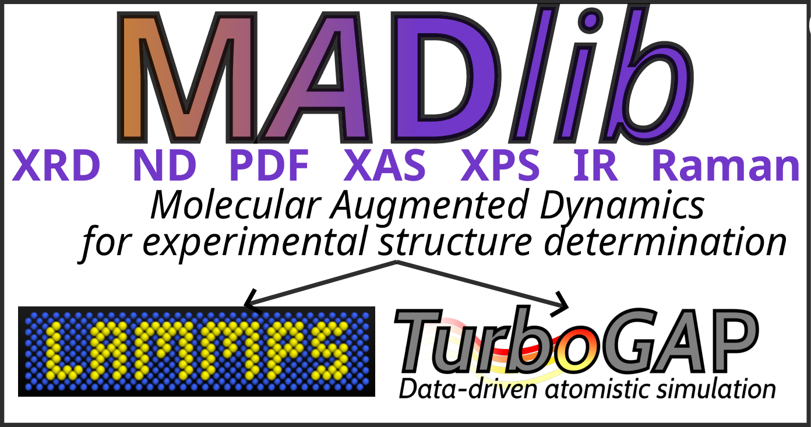

# MADlib: Molecular Augmented Dynamics for LAMMPS



A LAMMPS package that biases a simulation towards experimental data. MADlib
predicts an observable from the current configuration, penalises the mismatch
with a measurement, and adds the gradient of that penalty to the forces:

```
V_tot = V_pot + sum_o (gamma_o/2) sum_k w_k ( y_pred,k - y_exp,k )^2
```

It works with any LAMMPS potential. Observables that need a per-atom quantity
(core-electron binding energies, chemical shifts, dipoles) take it from any ML
model through one interface. The observables are ported from
[TurboGAP](https://turbogap.fi).

**Observables:** pair distribution function, structure factor, X-ray and neutron
diffraction, XPS, NMR, IR.

## What you can do

- Bias MD towards a measured `g(r)`, `S(q)`, XRD, neutron, XPS, NMR or IR spectrum.
- Run reverse Monte Carlo with LAMMPS's own MC fixes (`fix atom/swap`,
  `fix gcmc`, ...). The bias enters their acceptance test.
- Predict a spectrum without biasing (`gamma 0.0`).
- Evaluate a TurboGAP `.gap` potential in LAMMPS (`pair_style turbogap`).
- Get per-atom properties from TurboGAP GPR models, ML-IAP models, or any
  Python/torch model (MACE, GRACE, ...).
- Search for structures with a genetic algorithm that uses MAD as its local
  optimiser ([`python/`](python/README.md)).

## Quick start

```lammps
units      metal

compute gr  all mad/pdf r 0.1 6.0 201 kde 0.1
fix     xrd all mad/xrd c_gr target measured.fq q 1.05 9.97 201 &
                        output qFq species C O gamma 0.0 100.0

thermo_style custom step temp pe f_xrd f_xrd[2]
```

- **`f_xrd`** is the bias energy, and it is included in `pe`;
  `fix_modify xrd energy no` turns that off.
- **`f_xrd[2]`** is the relative error.
- **`gamma`.** Two values ramp `gamma` over the run. To choose `gamma`, run once
  with `gamma 0.0` and read the dissimilarity `f_xrd[3]`. Then pick `gamma` so
  that `gamma*D/2` is a small fraction of the cohesive energy.

Reverse Monte Carlo is the same fix next to an MC fix:

```lammps
fix mad  all mad/xrd c_gr target measured.fq q 1.05 9.97 201 species C O gamma 5.0
fix swap all atom/swap 5 20 29494 300.0 ke no types 1 2
```

## Examples

| | |
|---|---|
| [`examples/mace_foundation`](examples/mace_foundation/README.md) | a MACE foundation model under an experimental bias: the smallest useful MAD run with a machine-learned potential |

## Commands

### `compute ID group mad/pdf r <rmin> <rmax> <nbins> [keyword value ...]`

Differentiable partial pair distributions `g_ab(r)`. The output array has one
row per bin and the columns `r`, then one per species pair.

| keyword | default | meaning |
|---|---|---|
| `kde` | **required** | Gaussian width (Å); must be non-zero |
| `rcut` | `rmax + trunc*kde` | neighbour cutoff |
| `trunc` | `8.0` | Gaussian tails beyond this many sigma are dropped |
| `compat` | | `turbogap` reproduces TurboGAP's conventions |

### `fix ID group mad/pdf <compute> [keyword value ...]`

A bias towards a measured `g(r)`, or towards `D(r)` with `output`.

### `fix ID group mad/sq|mad/xrd <compute> [keyword value ...]`

Structure factor, X-ray and neutron diffraction.

| keyword | default | meaning |
|---|---|---|
| `q` | **required** | `<qmin> <qmax> <nq>` |
| `units` | `q` | `q` (1/Å) or `twotheta` (degrees) |
| `weighting` | `sq` / `xray` | `sq`, `xray`, `neutron` |
| `species` | | one element per atom type; required for `xray` and `neutron` |
| `output` | `raw` / `qFq` | `raw`, `F(q)`, `q*F(q)` |
| `wavelength` | `1.5405981` | Å |
| `window`, `window_cut` | `lorch`, `rmax` | real-space window and its range |
| `lp`, `polarization` | `no`, `1.0` | powder Lorentz-polarization factor |

### `fix ID group mad/xps|mad/spectrum <compute> [keyword value ...]`

A spectrum built by broadening a per-atom scalar, such as core-electron binding
energies.

| keyword | default | meaning |
|---|---|---|
| `energy` | **required** | `<emin> <emax> <nsamples>` |
| `sigma` | `0.4` | broadening width |
| `norm` | `l2` | `l2`, `area` or `none` |
| `trunc` | `8.0` | Gaussian truncation, in sigma |

### `fix ID group mad/nmr <compute> [keyword value ...]`

An NMR spectrum. The fix's group sets which nucleus it describes. A model
predicts a shielding σ, while an experiment reports a shift δ = a − bσ, so the
conversion must be stated.

| keyword | default | meaning |
|---|---|---|
| `range` | **required** | `<min> <max> <nsamples>`, ppm |
| `sigma` | `0.4` | broadening (ppm); the force scales as `1/sigma^2` |
| `reference`, `slope` | , `1.0` | `a` and `b` in δ = a − bσ |
| `convention` | | `shift` if the property already is a shift |

### `fix ID group mad/ir <N> <compute> [keyword value ...]`

An IR spectrum from the autocorrelation of the total dipole, stored every `N`
steps. With `target` and `gamma`, it also biases the run towards a measured
spectrum. All keywords are listed in [`doc/src/fix_mad_ir.rst`](doc/src/fix_mad_ir.rst).

```lammps
compute mu all mad/property/dipole charges 0.5 -0.5
fix     ir all mad/ir 2 c_mu nu_max 4000 acf_ratio 0.25 qc classical file ir.dat
```

### `compute ID group mad/property/*`

A per-atom property and its adjoint. Observables that need one (XPS, NMR, IR)
read it from one of these styles:

```lammps
compute q  all mad/property/turbogap gap_files/CO.gap core_electron_be species C O
compute q  all mad/property/python my_model ncomp 1 cutoff 5.0       # any Python/torch model
compute q  all mad/property/mliap model linear m.model descriptor sna m.descriptor
compute mu all mad/property/dipole charges 0.5 -0.5                   # or 'charge' for atom->q
compute cn all mad/property/coord cutoff 1.7 2.1
compute q  all mad/property/table file values.dat                     # prediction only
```

To add a model, implement one method. It must return the forces of a weighted
per-atom property, `sum_i lambda_i q_i`:

```cpp
virtual void adjoint(double **lambda, double *virial);
```

### `pair_style turbogap`

A TurboGAP potential, with all four of its terms (soap_turbo, distance_2b,
angle_3b and core_pot), read from a `.gap` file as it stands:

```lammps
pair_style  turbogap e0 C -.16138053 e0 O 0.0
pair_coeff  * * gap_files/CO.gap C O
```

| keyword | default | meaning |
|---|---|---|
| `e0 <species> <value>` | 0 | per-atom energy offset |
| `core_pot_cutoff`, `core_pot_buffer` | `1e10`, `1.0` | truncation of the tabulated core potential |

TS/MBD dispersion is not included. A dipole model (`dipole_model = .true.`) is
refused.

### Shared by every `fix mad/*`

`target <file>` (two columns), `gamma <g>` or `gamma <beg> <end>`, `every <N>`,
`fit <scale> <offset>`, `file <out>`, `write_every <N>`, `compat turbogap`.
`compute_vector` gives `{E, rel_error, dissimilarity, gamma, scale, offset}`.

## Building

```sh
ln -s /path/to/madlib/src/MADLIB /path/to/lammps/src/MADLIB
ln -s /path/to/madlib/lib/madlib /path/to/lammps/lib/madlib
cp /path/to/madlib/cmake-MADLIB.cmake /path/to/lammps/cmake/Modules/Packages/MADLIB.cmake
python tools/register_madlib.py /path/to/lammps      # registers the package with LAMMPS's cmake

cmake ../cmake -D PKG_MADLIB=on -D PKG_MC=on -D BUILD_MPI=on -D MADLIB_ENABLE_TURBOGAP=on
```

`MADLIB_ENABLE_TURBOGAP` builds the Fortran soap_turbo backend, which
`pair_style turbogap` and `mad/property/turbogap` need. It requires LAPACK.

For GPU SOAP, add:

```sh
-D MADLIB_ENABLE_GPU=on -D MADLIB_TURBOGAP_SRC=/path/to/turbogap/src \
-D MADLIB_GPU_ARCH=<sm> -D CUDAToolkit_ROOT=/path/to/cuda
```

## Tests

```sh
tests/run.sh                  # everything
tests/run.sh gradients mpi    # a subset
```

The tests compare against independent references and check forces and virials
by finite differences. They also check that a run on 1 rank matches a run on 4.
Tests that need the TurboGAP test data look under `$MADLIB_DATA_ROOT` and skip
when it is absent.
